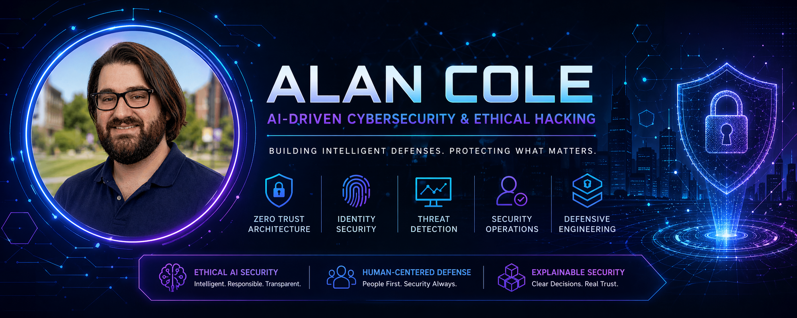
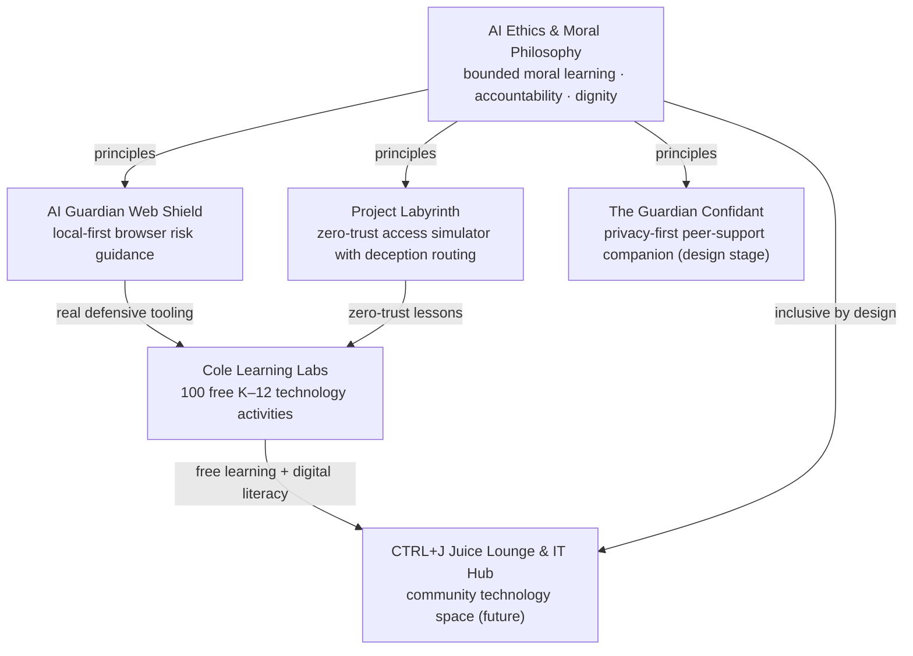
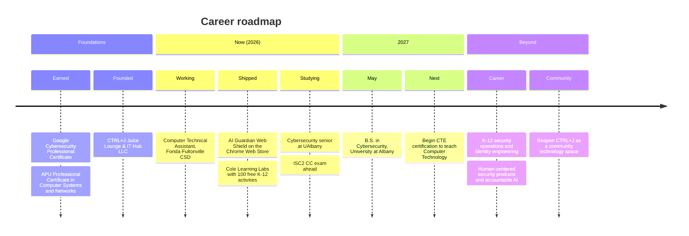

  

  <a href="https://www.colelearninglabs.com">Cole Learning Labs</a> ·
  <a href="https://chromewebstore.google.com/detail/ipledehmklfhhdpobeogfdhmhdhmnden">AI Guardian Web Shield</a> ·
  <a href="https://www.linkedin.com/in/alan91cole">LinkedIn</a> ·
  <a href="https://tryhackme.com/p/Alan91Cole">TryHackMe</a>

# Hi, I'm Alan "Al" Cole 👋

**K–12 technology support by day · cybersecurity senior by night · builder of Guardians in between**

I'm a Computer Technical Assistant at Fonda-Fultonville Central School District in New York's Mohawk Valley, finishing a B.S. in Cybersecurity at the University at Albany (SUNY), with a self-designed concentration in **AI-Driven Cybersecurity & Ethical Hacking** and a minor in **AI Ethics & Philosophy**. Students know me as Mx. Cole.

Most of what I build sits where three things meet: **defensive security**, **accountable AI**, and **people who were never handed a manual**. I like systems that explain themselves, interfaces anyone can use, and AI that protects without pretending to be something it isn't.

> I build security systems that think before they trust, and explain before they alarm.

## At a glance

| | |
| --- | --- |
| 🏫 **Now** | Computer Technical Assistant, Fonda-Fultonville CSD · B.S. Cybersecurity, UAlbany (expected May 2027) |
| 🧭 **Heading toward** | Career and Technical Education (CTE) certification to teach Computer Technology, plus K–12 security operations and identity engineering |
| 🛡️ **Building** | The Guardian family: local-first security tools, zero-trust simulations, and an ethics framework that ties them together |
| 🧪 **Teaching with** | [Cole Learning Labs](https://www.colelearninglabs.com): 100 free, browser-based technology activities for grades K–12 |
| 📍 **Based in** | Mohawk Valley, New York |
| 💬 **Ask me about** | Zero Trust, phishing psychology, accessible security UX, AI ethics, or how to teach a 4th grader what a DHCP lease is |

## Things I genuinely enjoy

- **Taking computers apart and putting them back together.** Enough that I built a guarded virtual PC workbench (18 screws, 8 removable parts, thermal paste included) so students can do it too without a screwdriver.
- **Teaching the tech team mindset.** "Follow the clues, try a fix, show how you know it worked." Every lab I write starts with a help-desk ticket, not a lecture.
- **Defensive security puzzles.** TryHackMe rooms, log review, phishing dissection, and designing honeypots that contain rather than retaliate.
- **Philosophy that actually ships.** I read moral philosophy and then try to turn it into access policies, audit logs, and UI copy.
- **Accessibility as craft.** Keyboard paths, reduced motion, plain language, and WCAG 2.2 AA are features, not afterthoughts.
- **Community spaces.** Gaming stations, a juice bar, and a help desk under one roof is still the dream (see CTRL+J below).
- **Building with AI, accountably.** I use AI coding agents regularly, review everything they write, and keep a human name on every decision.

## How my projects fit together

Everything I ship is part of one idea: a **Guardian** protects, explains, and leaves the final call with a human.

## Featured work

### 🧪 Cole Learning Labs

A free, browser-based technology learning platform I designed and built for K–12 students, educators, families, and adult beginners. Learners play the school tech team: read a ticket, follow the clues, repair simulated equipment or settings, test the result, and explain whether the original task works.

- **100 activities** across hardware and service desk, networking and operating systems, AI literacy and audit, ethical hacking and penetration testing, and a bounded JavaScript/Python coding sandbox.
- **Privacy-first by default.** Learner work stays on the device. AI literacy labs use authored examples and local rule checks, with no live AI API. Optional cloud replies are off until a learner explicitly turns them on, and even then only an authored scenario ID leaves the browser.
- **Accessible on purpose.** WCAG 2.2 AA targets, a Display menu for text size, spacing, contrast, and reduced motion, a Listen control, keyboard and touch alternatives for every physical interaction, and structured HTML alternatives for every PDF.
- **Built for real classrooms.** Grade-band starting points, progressive coaching clues that never do the work for the student, hypothesis-test reports, and a published AI-use notice for district review.

**Explore:** [colelearninglabs.com](https://www.colelearninglabs.com) · [View the repository](https://github.com/AL91Cole/cole-learning-labs)

### 🛡️ AI Guardian Web Shield

A published, privacy-first Chrome extension that analyzes webpage, link, and form signals locally and turns them into calm, plain-language risk guidance.

- Recognizes phishing indicators, suspicious links, lookalike domains, risky sign-in forms, and manipulative urgency.
- Connected form-action analysis warns when credentials could leak through a GET submission, an unencrypted destination, or a changed origin, without ever reading field values.
- Zero runtime dependencies, a no-network rule enforced in CI, and honest documentation of what the extension cannot see.

**Explore:** [Install from the Chrome Web Store](https://chromewebstore.google.com/detail/ipledehmklfhhdpobeogfdhmhdhmnden) · [View the repository](https://github.com/AL91Cole/ai-guardian-web-shield)

### 🔐 AI Guardian Assistant — Project Labyrinth

A defensive Zero Trust simulation that evaluates every access request using identity, role, device trust, MFA, behavior, and anomaly signals.

- Produces allow, deny, or deception-routing decisions and models least privilege, RBAC, and owner-only vault boundaries.
- Routes suspicious sessions into decoy containment with structured audit logging and SOC-style visibility. No hack-back, no retaliation.
- Built with Next.js, React, Tailwind CSS, and SQLite.

**Explore:** [View Project Labyrinth](https://github.com/AL91Cole/ai-guardian-assistant-project-labyrinth)

### 📚 AI Ethics and Moral Philosophy

A living research repository connecting moral philosophy with practical AI governance and security design.

- Develops my proposed framework of **bounded moral learning**: AI systems that can learn within explicit, human-set moral limits and must escalate rather than improvise beyond them.
- Examines human responsibility, concentrated power, dignity, consent, privacy, accessibility, accountability, appeal, and repair.
- Clearly separates my own philosophical proposals from established standards, and maps each principle onto Guardian systems, Zero Trust, and defensive deception.

**Explore:** [View AI Ethics and Moral Philosophy](https://github.com/AL91Cole/ai-ethics-and-moral-philosophy)

### 💙 The Guardian Confidant (design stage)

A proposed trauma-informed, privacy-first AI peer-support companion. The repository is intentionally design documentation only: a mission, a set of privacy boundaries, and a release gate that must be satisfied with evidence before any build is called safe for sensitive use.

**Explore:** [View The Guardian Confidant](https://github.com/AL91Cole/the-guardian-confidant)

## How I think about AI

I'm optimistic about AI and skeptical of AI hype, which is why I keep building things that test the difference.

- **Local-first, explain-first.** Analysis should happen on the user's device whenever possible, and a warning should say *why* in words a non-expert understands.
- **AI must not become a place where humans hide responsibility.** Every automated decision I design has a named human owner, an audit trail, and a path to appeal.
- **Off by default.** Cloud inference, memory, analytics, cameras, and microphones all start off and require an informed, visible choice to turn on.
- **Teach the audit, not just the tool.** My AI literacy labs ask students to review prompts, claims, bias, and generated code, minimize data, and reject source injection, because the next generation needs to question AI, not just use it.
- **Protect and contain, never retaliate.** Defensive deception and Zero Trust are about safely saying no, not about striking back.
- **Use AI to build, with a human signature.** AI coding agents help me move faster on my own projects. I review every line, keep secrets out of every prompt, and run privacy checks in CI on every push.

## Where I'm headed

I'm building toward work in:

- **K–12 technology education** through CTE certification, so students meet cybersecurity, networking, and responsible AI before they meet their first phishing email.
- **Security Operations and threat detection**, where plain-language explanations help teams and users act faster.
- **Identity and Access Management** and Zero Trust engineering for schools and public institutions.
- **Human-centered security products** that respect privacy, accessibility, and user choice.
- **Responsible and accountable AI** systems that keep humans answerable for what machines decide.

My long-term goal is to bridge technical security, ethical governance, accessibility, and real-world human needs.

## Toolbox

<table>
  <tr>
    <th align="left">Security engineering</th>
    <th align="left">Security operations</th>
    <th align="left">Systems and IT support</th>
    <th align="left">Development</th>
  </tr>
  <tr valign="top">
    <td>
      Zero Trust architecture 
      IAM, RBAC, least privilege 
      Risk-based policy decisions 
      Defensive deception design 
      Audit logging and visibility 
      Privacy-by-design
    </td>
    <td>
      Log review and anomaly recognition 
      Incident response and triage foundations 
      Threat modeling and attack surface 
      Phishing analysis and user-risk communication 
      Vulnerability awareness and prioritization
    </td>
    <td>
      Windows and Linux 
      K–12 endpoint and user support 
      TCP/IP, DNS, DHCP, VPN 
      System hardening and access control 
      Clear documentation and training
    </td>
    <td>
      JavaScript, React, Next.js, Tailwind CSS 
      Browser extensions (Manifest V3) 
      SQLite and SQL · Cloudflare Workers and D1 
      Python and PowerShell fundamentals 
      Accessible, explanation-first UI 
      Git, GitHub Actions, AI-assisted development
    </td>
  </tr>
</table>

## Credentials and hands-on learning

- **B.S. in Cybersecurity**, University at Albany (SUNY), expected May 2027
- **Google Cybersecurity Professional Certificate**
- **Professional Certificate in Computer Systems and Networks**, American Public University
- **ISC2 Certified in Cybersecurity** training completed; certification exam pending
- **TryHackMe** learning paths: Cyber Security 101 and Pre Security
- Ongoing practice through TryHackMe labs, local vulnerability audits, defensive simulations, and open-source project development

## Entrepreneurship and community

<strong>CTRL+J Juice Lounge & IT Hub™ LLC</strong> — an inclusive community technology space for the Mohawk Valley (on hold)

 

I founded CTRL+J to build a place where technology, community, accessibility, and human connection strengthen one another. The long-term vision brings together:

- a juice lounge and welcoming social space
- IT support, digital-literacy opportunities, and technology assistance
- accessible study and remote-work areas
- gaming stations, competitions, and community events
- a Safe Haven for everyone: young people, older adults, students, remote workers, and community members of every background

CTRL+J welcomes people regardless of race, religion, creed, disability, age, sexual orientation, or gender identity.

**Status:** On hold since October 12, 2026. CTRL+J remains a future goal with no current opening commitment. Cole Learning Labs carries its digital-literacy mission forward in the meantime.

## Guiding principles

- Security should be technically strong, ethically grounded, and understandable to the people it protects.
- AI must not become a place where human decision-makers hide responsibility.
- Privacy, dignity, accessibility, accountability, and meaningful user choice belong in the design from day one.
- Defensive security should protect and contain, not retaliate.
- The best security lesson is the one a student can explain back to you.

## Connect

- 🌐 [Cole Learning Labs](https://www.colelearninglabs.com)
- 💼 [LinkedIn](https://www.linkedin.com/in/alan91cole)
- 🐙 [GitHub](https://github.com/AL91Cole)
- 🎯 [TryHackMe](https://tryhackme.com/p/Alan91Cole)
- 🛡️ [AI Guardian Web Shield on the Chrome Web Store](https://chromewebstore.google.com/detail/ipledehmklfhhdpobeogfdhmhdhmnden)

This profile embeds no third-party images or trackers. See <a href="SECURITY.md">security reporting and repository privacy</a>.
